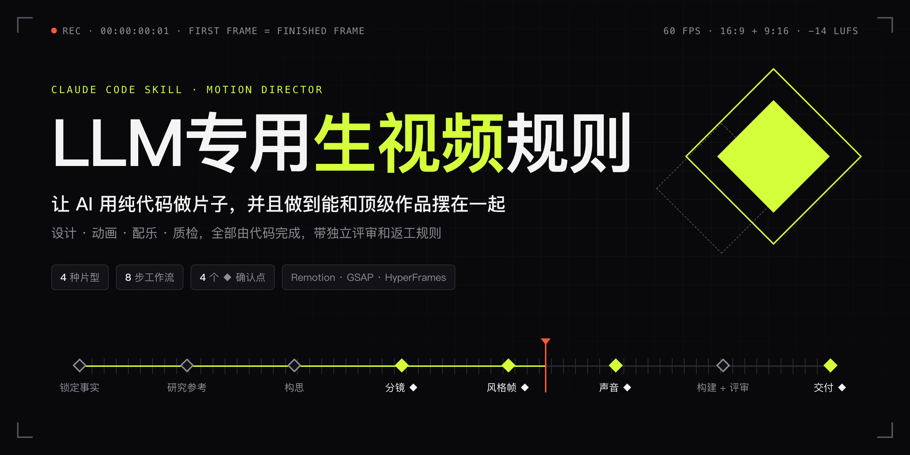
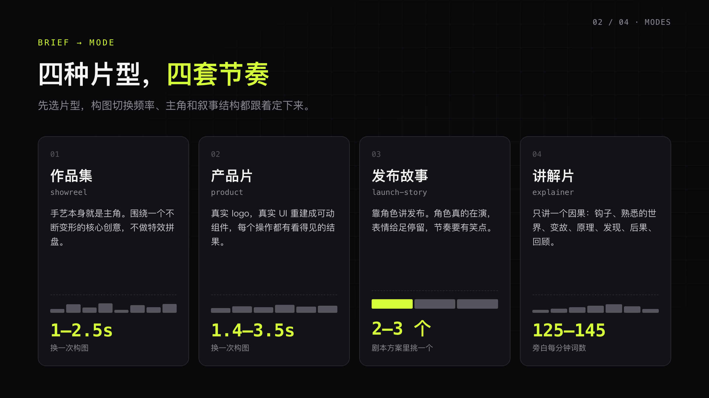
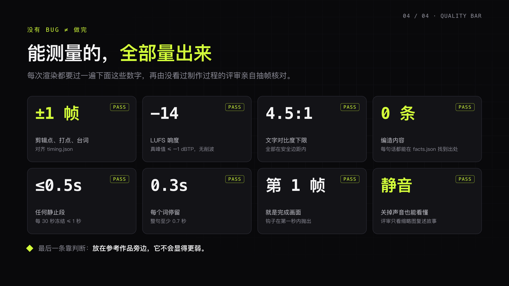

<p align="center">
  
</p>

<h1 align="center">LLM专用生视频规则</h1>

<p align="center">
  <b>让 AI 用纯代码做片子，并且做到能和顶级作品摆在一起。</b><br>
  一份给 Claude Code（或任何能写代码的 Agent）用的"动效导演"技能：从 brief、分镜、配乐到质检，每一步都有底线和验收数字。
</p>

<p align="center">
  
  
  
  
</p>

<p align="center"><a href="#english">English</a> · <a href="#快速开始">快速开始</a> · <a href="LLM专用生视频规则skill.md">完整规则</a></p>

---

## 为什么需要它

让 LLM 写代码做视频不难，难的是做得**好看**，还要**一次做对**。不给规则的话，常见的结果是：

- 特效堆成一锅，没有核心创意，也没有节奏
- 把产品截图当成一张静态图片贴上去，什么都不会动
- 文字像字幕一样闪过去，来不及读
- 随手编数据、编用户评价、编客户 logo
- 渲染、评审、再渲染，来回十几轮，token 和时间都烧在返工上

这套规则把一位动效导演的判断写成了 Agent 能执行的条款：**先定标准，再写代码，最后由一个没看过制作过程的评审拿数字验收。**

## 它规定了什么

<p align="center"></p>

**Brief 驱动。** 14 个字段（片型、观众、结尾感受、时长、帧率、品牌、事实来源、声音、自主度、工具链……）。留空的字段由 Agent 自己决定，并在 `brief.md` 里写一句理由。

**四种片型：** 作品集 / 产品片 / 发布故事 / 讲解片。构图切换频率、主角和叙事结构都跟着片型定。

**11 条工艺底线**，例如：
- 第一帧就是一张完成的画面，钩子在第一秒内抛出
- 转场靠画面内容本身完成；只有大小、方向和主体都对得上时才用硬切，而且只切在节拍上
- 不用线性缓动，速度永远在变；停留的镜头也要有细微的动作，不能冻住
- 不要装饰性粒子、泛滥的渐变和素材库里的故障效果

**先做声音，画面跟着声音剪。** 节拍、高潮点、人声进出帧都写进 `timing.json`，所有动画时间都从这个文件读。

## 新增：返工规则

<p align="center"></p>

原版规则要求每次渲染后都派一个全新的评审，实际用下来渲染和评审轮次太多。这里补了三条：

1. **第一轮评审把问题一次记全、写细。** 写进 `issues.md`，每条都有时间点、实测值、目标值、具体改法和验收方式，细到制作方不用回头问就能动手。
2. **清单清零前，不进下一轮全面评审。** 每条标"已修 / 未修 / 不改"，还有"未修"的就继续修。
3. **修完先做定点快检。** 只渲染改动的片段，派一个轻量评审只看改动区间前后 ±0.5 秒；快检通过后才渲染整片，做全面复查。

## 新增：只重渲改动的镜头

返工慢，很大一部分是因为改一个字也要把整片重新渲染一遍。`scripts/render-scenes.mjs` 把 HyperFrames 工程按镜头切开渲染：

- 每个镜头按内容算一个哈希（镜头文件、引用的素材、根层落在这个镜头里的元素、渲染参数）。哈希没变，就直接复用上次的片段。
- 只重渲改动的镜头，然后用 ffmpeg 无损拼接、套上总混音。拼接本身只要几秒。
- 给每个重渲镜头的前后切点各出一张接缝检查图（切点前后 ±0.5 秒，共 6 帧），定点快检直接看这张图。
- 根层的 GSAP 时间轴不用改：脚本会把它换成"从片段起点开始播"的代理时间轴。

```bash
node scripts/render-scenes.mjs path/to/project --dry-run   # 先看哪些镜头要重渲
node scripts/render-scenes.mjs path/to/project             # draft 画质，评审用
node scripts/render-scenes.mjs path/to/project --quality delivery --out renders/final.mp4
```

```text
  · f01        0.000 →    6.000  复用
  ▶ f02        6.000 →   12.000  重渲（内容变了）
  · f03       12.000 →   23.400  复用
要渲染 1 个，复用 10 个。
```

规则里也配了一张"改动类型 → 重渲范围"的对照表：只改混音不渲染画面，改一个镜头只渲染这一个；全面评审只在第一版成片、时间轴整体变化、交付前这三个节点做。

> 要求：Node 18+、HyperFrames CLI、ffmpeg/ffprobe（不在 PATH 上时设置 `FFMPEG_DIR`）。每个镜头要做成独立的 composition，由根层的宿主引用。首次运行会自动安装 HTML 解析器 `linkedom`。

## 能测量的，全部量出来

<p align="center"></p>

| 检查项 | 标准 |
|---|---|
| 剪辑点、打点、台词同步 | 与 `timing.json` 误差 ≤ 1 帧 |
| 响度 | 约 −14 LUFS，真峰值 ≤ −1 dBTP，无削波 |
| 文字对比度 | ≥ 4.5:1，全部在安全边距内 |
| 静止 | 任何静止段 ≤ 0.5 秒，每 30 秒冻结 ≤ 1 秒 |
| 文字停留 | 每个词约 0.3 秒，整句 ≥ 0.7 秒 |
| 事实 | 画面上每句话都能在 `facts.json` 找到出处，0 编造 |
| 静音可读 | 评审只看无声缩略图拼版，就能复述故事 |
| 判断项 | 放在参考作品旁边，它不会显得更弱 |

## 工作流

| # | 步骤 | 产物 | 确认点 |
|---|---|---|---|
| 1 | 锁定事实、收集真实素材 | `facts.json` | |
| 2 | 研究参考作品和目标观众 | 剪辑节奏笔记 | |
| 3 | 构思 2–3 个方向，挑一个，说出三个标志性瞬间 | 方向说明 | |
| 4 | 分镜表（关掉声音也要能看懂） | 分镜表 | ◆ |
| 5 | 风格手册 + 三张代码渲染的风格帧 | 风格手册 | ◆ |
| 6 | 声音和时间轴，先单独听纯音频 | 混音、`timing.json` | ◆ |
| 7 | 构建、合成，跑评审循环 | `issues.md`、`ledger.md` | |
| 8 | 交付 | 各画幅 MP4、纯音乐版、缩略图拼版、质检报告 | ◆ |

`autonomy: gated` 时每到 ◆ 停下来等你确认；`unattended` 则全程不停。

## 快速开始

```bash
git clone https://github.com/vincentcrc/llm-motion-director.git
mkdir -p ~/.claude/skills/LLM专用生视频规则
cp llm-motion-director/LLM专用生视频规则skill.md ~/.claude/skills/LLM专用生视频规则/SKILL.md
cp -r llm-motion-director/scripts ~/.claude/skills/LLM专用生视频规则/
```

> Claude Code 只认技能目录里名为 `SKILL.md` 的文件，所以复制时要改成这个名字。

然后在 Claude Code 里直接说，例如：

```text
用 LLM专用生视频规则 给我的产品做一支 30 秒的产品片，16:9 和 9:16 各一版。
产品链接：https://example.com，品牌从产品里提取，autonomy 用 gated。
```

不用 Claude Code 也可以：把 [`LLM专用生视频规则skill.md`](LLM专用生视频规则skill.md) 的正文当作系统提示词，交给任何能写代码、能跑 ffmpeg 的 Agent。

## 工具链

这套规则只管"做成什么样、怎么验收"，不绑定渲染框架：

- **HyperFrames**：HTML 逐帧渲染（toolchain 留空时推荐）
- **Remotion**：React 视频
- **HTML + GSAP**：自己搭渲染器
- **ffmpeg**：编码、抽帧、拼版、响度测量

## 来源说明

主体规则整理自社区流传的一份"动效导演"视频提示词。本仓库做了转录和结构化，修正了原文中音效音量前后矛盾的一处，并新增了**返工规则**和**执行备注**。如果你知道原作者，欢迎提 issue，我会补上署名。

---

<a id="english"></a>

## English

**LLM Video Rules** is a "motion director" skill for Claude Code and other coding agents. It turns a creative director's judgment into rules an agent can execute, so the agent can make videos entirely in code (design, animation, music, QA) that hold up next to the best work in their category.

- **Brief-driven:** 14 fields. Any field left blank is decided by the agent, with a one-line reason recorded in `brief.md`.
- **4 modes:** showreel, product, launch-story, explainer. Each mode sets its own pacing (e.g. a new composition every 1–2.5s for showreels; 125–145 wpm narration for explainers).
- **11 craft rules:** the first frame is a finished frame, transitions are carried by content, no linear easing, nothing ever freezes, no decorative particles.
- **Sound first:** beats, climaxes and vocal cues go into `timing.json`, and every animation time is read from it.
- **Critic loop with rework rules (new):** a fresh reviewer that never saw the production process writes a detailed `issues.md` in round one. The checklist must be cleared before the next full review. Every fix goes through a cheap targeted check first; full reviews happen only at three milestones.
- **Incremental scene rendering (new):** `scripts/render-scenes.mjs` splits a HyperFrames project into per-scene segments, hashes each one, re-renders only the scenes that changed, then losslessly concatenates them and muxes the master mix. It also outputs seam contact sheets around every re-rendered cut.
- **Measurable quality bar:** ±1 frame sync, −14 LUFS / −1 dBTP, 4.5:1 text contrast, ≤0.5s holds, zero fabricated claims, readable with the sound off.

Install by copying `LLM专用生视频规则skill.md` to `~/.claude/skills/<any-name>/SKILL.md` and the `scripts/` folder next to it. The rules are written in Chinese; modern LLMs follow them fine regardless of the language you prompt in.
